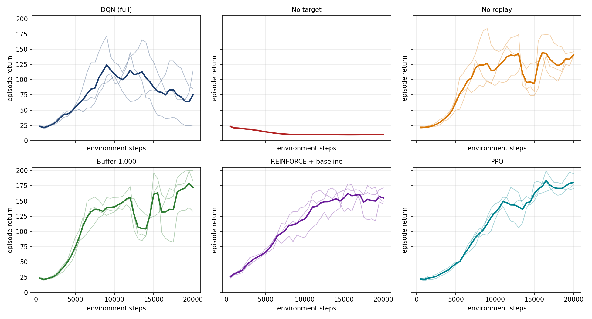
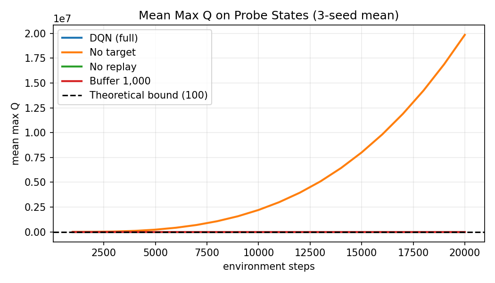

{
 "cells": [
  {
   "cell_type": "markdown",
   "id": "1087b1b9-cb3f-4ae4-a15a-918adfb195b3",
   "metadata": {},
   "source": [
    "## Training an RL Agent\n",
    "DQN, two ablations, REINFORCE and PPO written from scratch on CartPole,\n",
    "with the same budget and three seeds each.\n",
    "## Setup\n",
    "python -m venv .venv\n",
    "source .venv/bin/activate  # Windows: .venv\\Scripts\\activate\n",
    "pip install -r requirements.txt\n",
    "\n",
    "## Run\n",
    "Open `RipanDeepKour_N01454601_Lab09.ipynb` and run all cells from top to bottom:\n",
    "\n",
    "## Hardware\n",
    "- **Device:** CPU (Python 3.13, PyTorch)\n",
    "- **Total runtime:** ~2,010.5 seconds (~33.5 minutes).\n",
    "\n",
    "## Prediction (written before running piece 3)\n",
    "- **Removing the target network:** I predict this will severely hurt final return (dropping below 30) and cause Q-values to explode far above the theoretical bound of 100. Without a periodically frozen target network, the Bellman target shifts on every gradient step, creating an unstable feedback loop where Q-values chase their own overestimates.\n",
    "- **Removing the replay buffer (using only the most recent 64 transitions):** I predict this will hurt learning (dropping final return below 80 and preventing consistent reaching of 150) while keeping Q-values closer to the bound than the no-target ablation, because training sequentially on consecutive transitions breaks the i.i.d. sampling assumption and discards experiences after one update.\n",
    "\n",
    "## Decision rule\n",
    "Two configurations are counted as having a **real difference** on a metric (final return or steps to 150) only if their **3-seed ranges do not overlap**—meaning the minimum score across seeds `0, 1, 2` of the higher configuration is strictly greater than the maximum score across seeds `0, 1, 2` of the lower configuration. If the 3-seed ranges overlap, the difference is treated as inconclusive with three seeds.\n",
    "\n",
    "## Results\n",
    "\n",
    "### Checks (Piece 1)\n",
    "```text\n",
    "--- 1. Bootstrap ---\n",
    "Terminal (True):    1.0\n",
    "Non-terminal:       7.3\n",
    "Truncated only:     7.3\n",
    "\n",
    "--- 2. Huber Loss ---\n",
    "err= 0.5 | manual=0.1250 | torch=0.1250\n",
    "err= 3.0 | manual=2.5000 | torch=2.5000\n",
    "err=-3.0 | manual=2.5000 | torch=2.5000\n",
    "\n",
    "--- 3. Fixed Point (true value = 10.0) ---\n",
    "With target network:     9.9665\n",
    "Without target network:  10.0\n",
    "\n",
    "--- 4. PPO Clip (eps=0.2) ---\n",
    "ratio=1.3, adv=+1 -> 1.2000\n",
    "ratio=1.3, adv=-1 -> -1.3000\n",
    "ratio=0.7, adv=+1 -> 0.7000\n",
    "ratio=0.7, adv=-1 -> -0.8000\n",
    "\n",
    "--- 5. Return-to-Go ---\n",
    "[1, 1, 1], gamma=0.5 -> [1.75, 1.5, 1.0]\n",
    "```\n",
    "\n",
    "**Explanation of bootstrap and fixed-point checks:**\n",
    "- **Which transitions must bootstrap:** Both **non-terminal** transitions and **truncated-only** (200-step time limit) transitions must bootstrap (`1.0 + 0.9 * 7.0 = 7.3`), whereas true **terminal** transitions (pole fell or cart left the track) must not (`1.0`). Treating a time-limit truncation as terminal teaches the value function that surviving to step 200 yields zero future reward, penalizing optimal policies near the end of an episode.\n",
    "- **Fixed-point check:** On a single state-action loop (`r=1, gamma=0.9`), both runs converge to the true fixed point of `10.0` (`9.9665` with a target network synced every 50 steps; `10.0` without a target network). In a single-state deterministic loop without function-approximation interference across states, moving targets do not diverge—unlike multi-state CartPole where function approximation couples state values together.\n",
    "\n",
    "### DQN (Piece 2)\n",
    "| Seed | Final Return | Steps to 150 | Peak \\|Q\\| |\n",
    "| :--- | :---: | :---: | :---: |\n",
    "| 0 | 25.5 | None | 64.15 |\n",
    "| 1 | 85.3 | None | 60.70 |\n",
    "| 2 | 114.1 | 8500 | 59.76 |\n",
    "\n",
    "### Ablations (Piece 3)\n",
    "| Configuration | Seed 0 Final | Seed 1 Final | Seed 2 Final | Steps to 150 (0 / 1 / 2) | Peak \\|Q\\| (0 / 1 / 2) |\n",
    "| :--- | :---: | :---: | :---: | :---: | :---: |\n",
    "| DQN (full) | 25.5 | 85.3 | 114.1 | None / None / 8500 | 64.15 / 60.70 / 59.76 |\n",
    "| No target | 9.6 | 9.6 | 9.6 | None / None / None | 88,435,224.00 / 74,567,896.00 / 73,088,840.00 |\n",
    "| No replay | 145.7 | 139.6 | 137.3 | 8000 / None / 11500 | 61.06 / 61.57 / 61.64 |\n",
    "| Buffer 1,000 | 133.0 | 200.0 | 182.8 | 15000 / 7000 / 11500 | 55.86 / 55.54 / 55.65 |\n",
    "\n",
    "**Q-values vs. theoretical bound (100) and ablation analysis:**\n",
    "- **Theoretical bound:** With reward `+1` per step and `gamma = 0.99`, the maximum possible true return is `1 / (1 - 0.99) = 100`.\n",
    "- **No target:** Matched my prediction closely—final return collapsed to `9.6` on every seed and `peak |Q|` exploded to `7.3e7 – 8.8e7` (nearly a million times the bound of 100) due to unchecked bootstrapping feedback.\n",
    "- **No replay & Buffer 1,000 (surprising result):** Contrary to my prediction that removing the replay buffer would hurt performance, `No replay` (`137.3–145.7`) and `Buffer 1,000` (`133.0–200.0`) both outperformed `DQN (full)` (`25.5–114.1`) within the 20,000-step budget, while keeping `peak |Q|` safely below 100 (`55.5–61.6`). Because `epsilon` decays slowly over the first 8,000 steps, a 20,000-capacity buffer retains stale exploratory transitions for the entire run, diluting gradients from newer on-policy trajectories.\n",
    "- **What `Buffer 1,000` separates:** Removing the replay buffer changes two things at once: (1) samples become temporally correlated and (2) old transitions are discarded immediately. `Buffer 1,000` restores i.i.d. uniform sampling while still flushing stale early transitions every 1,000 steps. Because `Buffer 1,000` achieved higher returns (`133.0–200.0`) than `No replay` (`137.3–145.7`), it shows that **discarding stale early transitions** explains the short-budget improvement over a 20k buffer, while **decorrelated uniform sampling** still provides an advantage over strictly sequential updates.\n",
    "\n",
    "### Policy Gradient (Piece 4)\n",
    "| Agent | Seed | Final Return | Steps to 150 | Wall-Clock Time (s) |\n",
    "| :--- | :---: | :---: | :---: | :---: |\n",
    "| REINFORCE + baseline | 0 | 148.6 | 11000 | 19.32 |\n",
    "| REINFORCE + baseline | 1 | 171.5 | 11000 | 11.07 |\n",
    "| REINFORCE + baseline | 2 | 145.1 | 15000 | 10.00 |\n",
    "| PPO | 0 | 170.3 | 15000 | 21.73 |\n",
    "| PPO | 1 | 194.5 | 11000 | 21.52 |\n",
    "| PPO | 2 | 176.3 | 11000 | 20.94 |\n",
    "\n",
    "### Comparison (Piece 5)\n",
    "\n",
    "\n",
    "\n",
    "| Agent | Seed 0 Final | Seed 1 Final | Seed 2 Final | 3-Seed Range (Final) | Steps to 150 (0 / 1 / 2) | Total 3-Seed Time (s) |\n",
    "| :--- | :---: | :---: | :---: | :---: | :---: | :---: |\n",
    "| DQN (full) | 25.5 | 85.3 | 114.1 | [25.5, 114.1] | None / None / 8500 | 352.05 |\n",
    "| No target | 9.6 | 9.6 | 9.6 | [9.6, 9.6] | None / None / None | 547.42 |\n",
    "| No replay | 145.7 | 139.6 | 137.3 | [137.3, 145.7] | 8000 / None / 11500 | 495.74 |\n",
    "| Buffer 1,000 | 133.0 | 200.0 | 182.8 | [133.0, 200.0] | 15000 / 7000 / 11500 | 510.74 |\n",
    "| REINFORCE + baseline | 148.6 | 171.5 | 145.1 | [145.1, 171.5] | 11000 / 11000 / 15000 | 40.40 |\n",
    "| PPO | 170.3 | 194.5 | 176.3 | [170.3, 194.5] | 15000 / 11000 / 11000 | 64.19 |\n",
    "\n",
    "**Decision-rule evaluation (non-overlapping 3-seed final-return ranges):**\n",
    "- **Pass (real difference):**\n",
    "  - `DQN (full)` `[25.5, 114.1]` vs. `No target` `[9.6, 9.6]` — target network prevents catastrophic collapse.\n",
    "  - `No replay` `[137.3, 145.7]`, `Buffer 1,000` `[133.0, 200.0]`, `REINFORCE + baseline` `[145.1, 171.5]`, and `PPO` `[170.3, 194.5]` all strictly beat `DQN (full)` `[25.5, 114.1]` and `No target` `[9.6, 9.6]`.\n",
    "  - `PPO` `[170.3, 194.5]` vs. `No replay` `[137.3, 145.7]` — PPO's worst seed (`170.3`) beats `No replay`'s best seed (`145.7`).\n",
    "- **Fail / Inconclusive (ranges overlap):**\n",
    "  - `PPO` `[170.3, 194.5]` vs. `Buffer 1,000` `[133.0, 200.0]` (overlaps across `170.3–194.5`).\n",
    "  - `PPO` `[170.3, 194.5]` vs. `REINFORCE + baseline` `[145.1, 171.5]` (overlaps slightly at `170.3–171.5`).\n",
    "  - `Buffer 1,000` `[133.0, 200.0]` vs. `No replay` `[137.3, 145.7]` and vs. `REINFORCE + baseline` `[145.1, 171.5]`.\n",
    "  - **Steps to 150:** No pair passes the decision rule because every learning agent either overlaps in `[7000, 15000]` or contains `None`.\n",
    "\n",
    "## Conclusion\n",
    "- **Which agent for which job:**\n",
    "  - **For reliable high return and fast wall-clock training on a 20k budget:** Choose **PPO**. It achieved the highest minimum and mean final return (`170.3, 194.5, 176.3`) and finished all three seeds in `64.19 s` (~5.5x faster than `DQN (full)` at `352.05 s`) because it updates in mini-batches every 1,024 environment steps rather than running a gradient update on every single environment step.\n",
    "  - **For fastest raw wall-clock execution when moderate returns suffice:** Choose **REINFORCE + baseline** (`40.40 s` total across 3 seeds, final returns `145.1–171.5`).\n",
    "  - **For off-policy value learning under a tight non-stationary budget:** Choose **DQN with a smaller replay buffer (`Buffer 1,000`)** (`133.0–200.0`) rather than a 20,000-step buffer (`25.5–114.1`).\n",
    "- **Measurements arguing against each choice:**\n",
    "  - **Against PPO:** On `steps_to_150`, seed 0 took `15,000` steps—slower than `Buffer 1,000` (`7,000` on seed 1) and `DQN (full)` (`8,500` on seed 2)—showing that on-policy rollout collection can be slower to hit initial competency than off-policy updates on lucky seeds.\n",
    "  - **Against REINFORCE + baseline:** Its final returns (`145.1–171.5`) lagged behind PPO (`170.3–194.5`), and its high variance across episodes limits peak stability.\n",
    "  - **Against Buffer 1,000:** It required `510.74 s` of CPU time (nearly 8x slower than PPO) and had wider seed-to-seed spread (`133.0` to `200.0`).\n",
    "- **What three seeds on one small task can and cannot establish:**\n",
    "  - Three seeds on `CartPole` clearly establish catastrophic failure modes (such as Q-value divergence without a target network) and large wall-clock speed gaps between per-step off-policy updates and rollout-based on-policy updates.\n",
    "  - They cannot establish fine-grained rankings between competitive algorithms whose 3-seed ranges overlap (such as `PPO` vs. `Buffer 1,000`), nor do they generalize to high-dimensional observations, continuous action spaces, or longer training horizons where a 20,000-transition buffer eventually stabilizes.\n",
    "\n",
    "## Known limitations\n",
    "- Evaluated on a single 4-state, 2-action control task (`CartPole`) with a fixed 20,000-step budget.\n",
    "- Only three seeds (`0, 1, 2`) were tested, leaving overlapping ranges across several top-performing configurations.\n",
    "- Hyperparameters (learning rates, buffer sizes, epsilon decay schedule) were fixed by lab specification rather than tuned per algorithm."
   ]
  },
  {
   "cell_type": "code",
   "execution_count": null,
   "id": "c1bbdb59-cfe5-4b0a-acd1-e08092f62bfb",
   "metadata": {},
   "outputs": [],
   "source": []
  },
  {
   "cell_type": "code",
   "execution_count": null,
   "id": "da2f9cdd-36dd-46eb-b3cd-0287026c292b",
   "metadata": {},
   "outputs": [],
   "source": []
  }
 ],
 "metadata": {
  "kernelspec": {
   "display_name": "Python [conda env:base] *",
   "language": "python",
   "name": "conda-base-py"
  },
  "language_info": {
   "codemirror_mode": {
    "name": "ipython",
    "version": 3
   },
   "file_extension": ".py",
   "mimetype": "text/x-python",
   "name": "python",
   "nbconvert_exporter": "python",
   "pygments_lexer": "ipython3",
   "version": "3.13.9"
  }
 },
 "nbformat": 4,
 "nbformat_minor": 5
}
